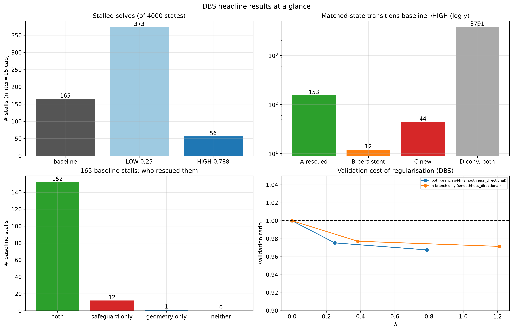
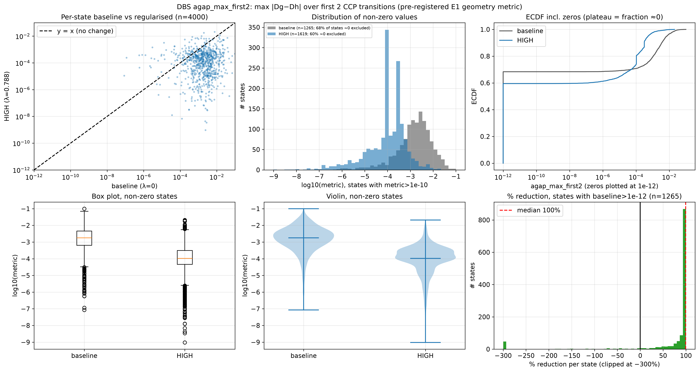
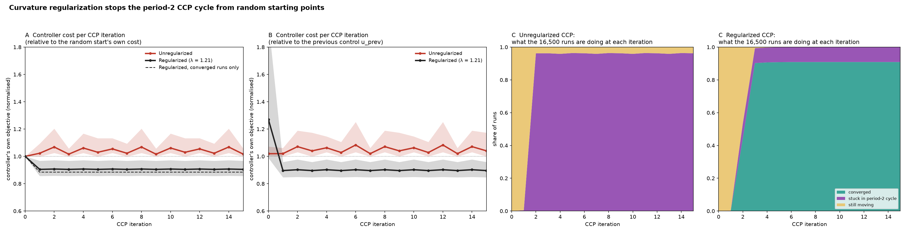
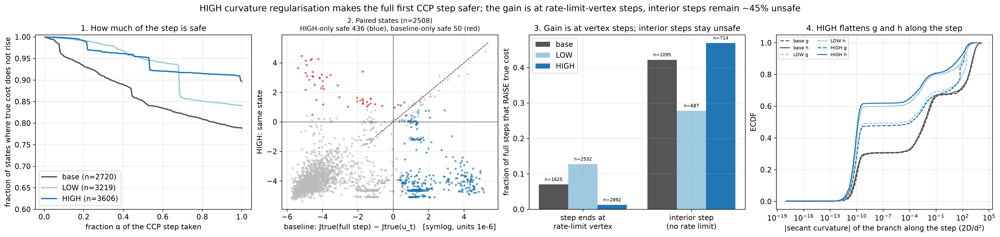
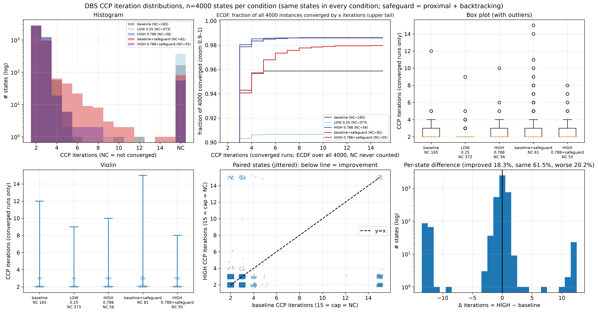
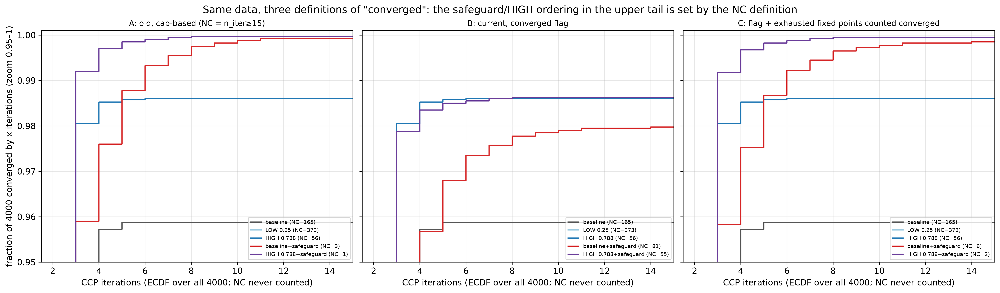
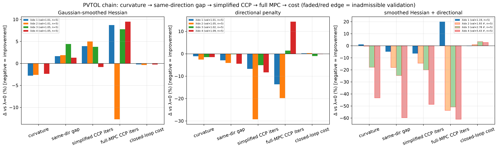
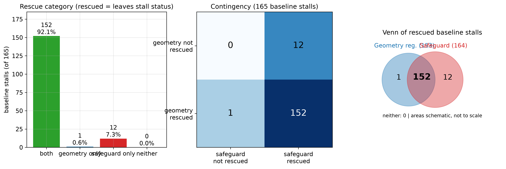

# DCNN Curvature

Difference-of-convex neural networks (DCNNs) for convex-concave-procedure (CCP) model predictive control, with interchangeable curvature regularisers for the concave branch.


## 1. Problem and method

A learned dynamics model is written as $f(x) = g(x) - h(x)$, where $g$ and $h$ are input-convex neural networks (ICNNs). Convexity of both branches is enforced by construction: convex-path weights are projected non-negative after every optimiser step. Inside an MPC controller, CCP linearises $-h$ at the current iterate and solves a convex problem, repeatedly.

Because $h$ is piecewise linear (ReLU), its classical Hessian is zero almost everywhere, so the usual trust-region argument for the linearisation error says nothing. The error of linearising $h$ between two points is instead its **Bregman divergence**

$$
D_h(x', x) = h(x') - h(x) - \nabla h(x)^\top (x' - x) \ge 0
$$

which is zero while both points sit on one linear piece and jumps when a step crosses a kink. This repository trains DCNNs with penalties that reduce this quantity and compares them on one shared harness:

| mode | idea |
|---|---|
| `smoothhess_trace`, `smoothhess_directional` | Gaussian-smoothed Hessian $H_\sigma$ via Stein's lemma, isotropic or along real CCP step directions |
| `ccp_directional`, `hybrid`, `tangent_gap` | directional and forward-only finite-difference proxies |
| `exact_hessian` | train with softplus (exact Hessian), anneal $\beta$, swap to ReLU, fine-tune |
| `jacobian_variation` | penalise local variation of the gradient |

## 2. Main findings

Evidence comes from deep brain stimulation (DBS) recordings replayed through a CCP-based MPC: 4000 controller states (500 per seed, 8 independently trained models), each solved with the baseline model, regularised models and a solver safeguard, so every comparison is paired state by state. Only what the saved results support is claimed. Numbers below are derived from the tables in `results/dbs/`.

- **Curvature and Bregman gap fall at unchanged fidelity.** Both-branch regularisation lowers curvature by 34% to 58% and the surrogate gap $|D_g - D_h|$ by 85% to 92%, with validation ratio $0.97$ to $0.98$.
- **Fewer CCP stalls.** Solves hitting the 15-iteration cap fall from 165 to 56 of 4000 at the higher $\lambda$ (0.788). The lower $\lambda$ (0.25) raises them to 373, so the effect is not monotone in $\lambda$.
- **Mechanism.** Every examined stall is a period-2 cycle between the two rate-limit vertices.
- **Regularisation is not free for individual states.** 153 baseline stalls are rescued, 12 persist, 44 new stalls appear.
- **A plain solver safeguard rescues the same stalls** (164 of 165, 152 shared with regularisation).
- **Not shown:** fewer iterations among converged solves (2.29 vs 2.33), lower plant-surrogate cost, closed-loop benefit, or any runtime gain.

## 3. Headline



Top left: stalled solves per model. Top right: baseline versus regularised outcome for the same state. Bottom left: which method fixes a baseline stall. Bottom right: validation cost of regularisation.

## 4. Curvature and accuracy

Each dot is one independently trained model; lines are means over 8 seeds. Two $\lambda$ per family (both-branch, h-only). `DBS_pareto_accuracy_vs_geometry` shows the accuracy cost against geometry gain.



## 5. Stalls and CCP behaviour



From random starting points on the 165 baseline stall states, the unregularised CCP settles into a period-2 cycle while the regularised model ($\lambda = 1.21$) mostly converges. Each controller uses its own learned model, so panels A and B compare each controller's own objective, not plant performance.



Regularisation makes the full first CCP step safer (true cost does not rise), but the gain is at rate-limit-vertex steps; interior steps remain about 45% unsafe.





The same data under three definitions of "converged": the safeguard/regularised ordering in the upper tail depends on the definition.



PVTOL (earlier width-160 sweep): the full chain from curvature to gap to CCP iterations to cost appears only at inadmissible validation (faded bars, validation ratio 1.9 to 5.4), and closed-loop cost does not improve.

The mean-iteration benefit disappears among converged solves (`DBS_mean_iterations_with_without_stalls`), so it is stall removal, not faster ordinary solves. More: `DBS_stall_counts_bar`, `DBS_stall_flow_sankey` (in `figures/dbs/`).

## 6. Regulariser versus safeguard



The overlap is explained by both methods breaking the same two-vertex cycle. This is inferred from logged iterates, not a causal proof.

## 7. Installation

Requires Python 3.10+ (developed and tested on 3.12). Locked environment with [uv](https://docs.astral.sh/uv/):

```bash
uv sync --extra dev
```

or `pip install -r requirements-dev.txt && pip install -e .` (`requirements.txt` for runtime only). Tested with torch 2.14, cvxpy 1.9.3 on macOS (CPU only).

## 8. Quick start

```bash
python scripts/generate_pvtol_data.py                      # synthetic PVTOL test system, seed 0
python scripts/train.py --config configs/baselines_pvtol/smoothhess_directional.yaml
python scripts/compare_methods.py --configs configs/baselines_pvtol/*.yaml
```

A single training run on the synthetic PVTOL system took about 7 minutes on a laptop CPU.

## 9. Reproducing the results

| step | command |
|---|---|
| tests | `pytest -q` |
| datasets | `python scripts/generate_{pvtol,unicycle,vanderpol}_data.py` (explicit seeds; outputs identical to the development datasets) |
| DBS figures | PNG figures and derived tables are included. `scripts/figures_dbs/` is the plotting code. It reads raw DBS solve logs (not included) from `DBS_RESULTS_ROOT`, so it is provenance, not runnable from this repo alone. |


## 10. Repository structure

```
src/dcnn_curvature/      models (ICNN, DCNN), curvature penalties, training loop, CCP solver, MPC, metrics
configs/                 one config per method and system
scripts/                 training, comparison, data generators, figures
scripts/figures_dbs/     plotting code for the DBS figures (needs raw logs, not included)
results/                 small derived tables behind the public figures (results/dbs)
figures/                 PVTOL chain figure (PNG)
figures/dbs/             DBS figures (PNG)
tests/                   301 tests (convexity, penalty gradients not a no-op, Bregman identity, CCP, pipeline)
```

## 11. Limitations

- No improvement in closed-loop iterations, plant-surrogate cost or runtime is demonstrated.
- DBS results rely on a surrogate plant (a placeholder), replayed states and N = 1, with two $\lambda$ per family. The $\lambda$ dependence is non-monotone. Signals are normalised recordings without recorded physical units.
- Figures and derived tables are included but the raw DBS recordings are not. Public tests substitute generated Van der Pol data and skip the real-data test.
- DBS models have no saved training history, so no DBS learning curves are shown.

## 12. Citation, licence and acknowledgements

- Author: Alexander Springford
- Licence: [MIT](LICENSE)
- Citation: see [`CITATION.cff`](CITATION.cff).

The PVTOL test system follows the dynamics of Doff-Sotta, A-Rahman and Cannon, "Computationally Tractable Robust Nonlinear MPC using DC Programming" (reference implementation: [martindoff/DC-NN-MPC](https://github.com/martindoff/DC-NN-MPC)). Only the published model equations are used; this repository contains its own implementation. The Stein's-lemma smoothed-Hessian approach and related curvature penalties are implemented here from the literature.
